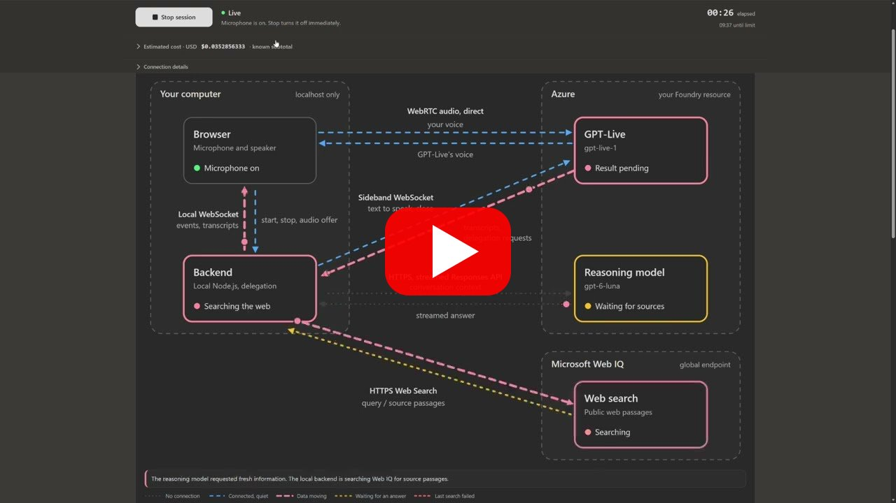

# GPT-Live Lab

[](https://github.com/jhchein/gpt-live-lab/actions/workflows/ci.yml?query=branch%3Amain)

A local voice demo for Azure GPT-Live client delegation. Talk to GPT-Live, watch a separate reasoning model work, and inspect streamed answers, optional web research and estimated session cost.

The browser runs React and Vite. A small Node.js backend handles Azure CLI authentication and model calls. You bring your own Azure resource and deployments.

[](https://youtu.be/RPRjVVv27NY)

*In the demo video, GPT-Live explains this lab. The repository address comes from the operator through `DEMO_CONTEXT`, not from the model itself.*

## Run locally

You need:

- Node.js 22.12+ and [Azure CLI](https://learn.microsoft.com/cli/azure/install-azure-cli).
- An Azure AI Foundry resource with a `gpt-live-1` deployment that supports WebRTC client delegation.
- A reasoning deployment on the same resource that supports streamed Responses requests, `store: false` and `max_output_tokens`. Web search also needs Function Calling and encrypted reasoning continuation.
- An Azure CLI identity with inference access to both deployments.
- Edge or Chrome with microphone permission. Embedded editor browsers may not support it.

```powershell
git clone https://github.com/jhchein/gpt-live-lab.git
cd gpt-live-lab
npm ci
Copy-Item .env.example .env
az login
```

On macOS or Linux, use `cp .env.example .env`. For a specific tenant, run `az login --tenant YOUR_TENANT_ID`.

Fill in `.env`. There are no defaults, and the backend stops with a setup message if a required value is missing.

| Variable | Value |
| --- | --- |
| `AZURE_ENDPOINT` | Required. The HTTPS resource origin, with no API path. |
| `AZURE_LIVE_DEPLOYMENT` | Required. Your GPT-Live deployment name. |
| `AZURE_REASONING_DEPLOYMENT` | Required. Your reasoning deployment name. |
| `AZURE_TENANT_ID` | Optional. Defaults to your Azure CLI login's tenant. |
| `DEMO_CONTEXT` | Optional, up to 500 characters. Names or addresses added to both model prompts so they can recognize them. It does not describe their contents, so questions about them still need research. |

Deployment names are the names you assigned in Azure, not model IDs.

```powershell
npm run dev
```

Open <http://127.0.0.1:5173>, select **Start session** and allow microphone access. Try a calculation or a question that needs comparison. GPT-Live decides whether to delegate. Azure is contacted only after Start, and no API key or Azure token reaches the browser.

Azure usage is billable. WebRTC sessions have a 15-second minimum billable duration, and Live and reasoning usage may be billed separately. Sessions stop after ten minutes, which is not a spending cap.

## Optional web research

1. Create a [Microsoft Web IQ resource and API key](https://learn.microsoft.com/web-iq/get-started/deploy-azure-portal).
2. Set `WEB_IQ_API_KEY` in `.env`. Never use a `VITE_` prefix, which would expose it to the browser.
3. Restart the backend.

With a key, the **Web search** switch starts enabled and applies to the next delegation. Ask for current information. The reasoning model decides whether to call `web_search`, the backend runs the search, and cited sources appear under that delegation. Without a key, voice and reasoning work as before.


*Illustrative session with simulated activity. The reasoning model asked for a source and waits while the backend queries Web IQ.*

Limits and behavior:

- Only Web Search is enabled. Each query requests up to five results with strict SafeSearch.
- A delegation has a 120-second deadline across all model and search steps. The backend sends at most 100 searches per rolling minute, without counting other applications that share the key.
- HTTP 503 gets one automatic retry. A valid `Retry-After` sets the wait, otherwise the backend waits 1 to 1.5 seconds. Each dispatched attempt enters the cost estimate; failed attempts may still be billable. Other errors, including 401, 403 and 429, are not retried.
- Web IQ receives model-written queries, not the full transcript, but queries can still contain private details.
- Sources are untrusted. A citation is marked only when the model uses a returned source ID, which verifies the reference and not the claim.
- The demo does not send citation or click telemetry. If your Web IQ profile enables instrumentation, the demo shows a warning.

## Configure the cost ticker

Set these optional values in `.env` and restart the backend.

| Variable | Unit or default |
| --- | --- |
| `LIVE_USD_PER_MINUTE` | Live audio rate in USD per minute. Multiply a per-second rate by 60. |
| `LIVE_MINIMUM_SECONDS` | Minimum billable Live duration. Default `15`. |
| `LIVE_ROUNDING_SECONDS` | Billing increment in seconds. Default `1`, must be greater than zero. |
| `INPUT_USD_PER_MILLION` | USD per million uncached input tokens. |
| `CACHED_INPUT_USD_PER_MILLION` | USD per million cached input tokens. |
| `OUTPUT_USD_PER_MILLION` | USD per million output tokens, including reasoning tokens. |
| `WEB_USD_PER_THOUSAND` | USD per 1,000 Web Search calls. Default `7`, the public rate [verified on October 22, 2026](https://learn.microsoft.com/web-iq/resources/pricing). A blank value means unknown. |

Model rates have no defaults. Blank means unknown, and `0` means free.

**Estimated cost · USD** updates every second. Before final Live usage arrives, it uses the larger of reported seconds and local elapsed time. The final reported seconds replace that figure, so the amount can go down. Missing rates or usage produce a labeled **known subtotal**. The result is an estimate, not an invoice, and premium web content may cost extra.

## Read the demo


*Illustrative session with simulated activity, not a recorded or measured run. Audio stays connected between browser and GPT-Live while the backend waits for the reasoning model.*

- **Live connections** shows your browser and backend, the Azure models, and Web IQ. Arrows show open connections, traffic and waiting. Dots are observed messages, not network packets.
- **Conversation** shows the transcript with clickable delegation markers.
- **Delegations** shows each reasoning timeline. Expand a request, answer, delivery chunk or trace event to inspect it.
- **Usage** shows reasoning requests, reported tokens and Live seconds.
- **Raw events** filters the latest 600 events and shows their JSON.

The transcript keeps the latest 800 fragments, so old traces can become incomplete. Usage totals cover the whole session.

During a 503 retry, the Web IQ node shows a countdown, then `Retrying · 2/2`. A final failure turns only the search node and arrows red, and the voice connection stays independent. A partial token total is a lower bound, and cached and reasoning tokens are subsets, not additions.

## How it works

```text
Browser -- SDP and local controls --> Node backend -- authenticated session --> Azure GPT-Live
Browser <=========================== WebRTC audio ===========================> Azure GPT-Live
Browser <-- local trace WebSocket -- Node backend <-- sideband events -------- Azure GPT-Live
                                           |
                                           +-- streamed Responses API --> reasoning model
                                           +-- HTTPS search -----------> Microsoft Web IQ
```

The backend creates a GPT-Live session with `delegation.type: "client"` and attaches a sideband WebSocket. Audio travels directly between browser and Azure.

When GPT-Live delegates, the backend waits 300 ms for in-flight transcript fragments, takes roughly the latest 32 KB of text, and asks the reasoning model about the latest open user question. This simple context selection can misread rapid topic changes.

Completed sentences go back to GPT-Live as `session.commentary.append` events while the reasoning response streams. With search enabled, preliminary text is held until sources arrive or the model finishes without a tool call. Citation markers are shown but not spoken. Encrypted reasoning state stays in memory and is removed from traces and exports.

Both models receive the current date, time and system time zone, so relative dates such as "today" use the backend's clock. The reasoning model gets a fresh snapshot on every step.

Internal `luna.*` event names mean reasoning calls, whatever your deployment is called.

## Troubleshooting

- **Backend unavailable.** Fill in the required `.env` values, restart `npm run dev`, and free ports 5173 and 3001.
- **No microphone.** Use Edge or Chrome. Use **Test microphone** to grant permission, stop the test, then select a named device.
- **No sound.** Check the audio player and system output. Select **Enable playback** if autoplay is blocked. **Audio diagnostics** shows received bytes and signal energy. A moving input meter proves local capture only.
- **No delegation.** Ask something that needs reasoning. GPT-Live decides.
- **Azure 401/403.** Check your Azure CLI sign-in, inference permissions and the resource's network policy.
- **Web search not configured.** Put the key in the backend's `.env` and restart. A Web IQ 401/403 concerns that key and profile, not model access.
- **Tools rejected by the model.** Disable Web search, or use a reasoning deployment that supports Function Calling and encrypted continuation.
- **Missing final usage.** The connection closed before Azure confirmed shutdown. The interface shows the amount as uncertain instead of zero.

## Privacy and limits

- Audio and transcript context go to Azure. Search queries go to Web IQ when enabled. Responses use `store: false`, but provider logging and retention policies still apply.
- History lives in memory only. There is no analytics service or durable store.
- **Export session** downloads conversation text, model requests and responses, and usage. Credentials, SDP, encrypted state and microphone identifiers are redacted. Free text can still hold private data, so review exports before sharing.
- Git ignores `.env` files, build output, logs and export filenames. Never commit credentials, real resource identifiers or screenshots of private sessions.
- The app supports one browser connection, one active delegation and up to four queued ones.
- Stop releases the microphone immediately and requests Azure shutdown. Cancelling does not guarantee Azure stopped computing.
- The servers bind to loopback. Before exposing them as a shared service, add authentication, authorization and spending controls.

## Development

```powershell
npm test
npm run build
```

Tests use local mocks and need no Azure credentials. The build runs strict TypeScript checks, rejects unused symbols and produces the Vite frontend.

GitHub Actions runs both commands on Node.js 22 and 24 for pull requests to `main` and pushes to `main`. Both CI jobs are required for merges to `main`, and the PR branch must be up to date. CI needs no Azure credentials or Web IQ key and does not deploy the app.

The [architecture guide](docs/architecture.md) maps responsibilities and explains startup, delegation, shutdown and error handling. Module-specific tests live next to their implementation; [`tests/`](tests/) holds cross-module checks. [`CONTEXT.md`](CONTEXT.md) defines the project's terms.

## References

- [GPT-Live WebRTC](https://learn.microsoft.com/azure/foundry/openai/how-to/gpt-live-webrtc)
- [Client delegation](https://learn.microsoft.com/azure/foundry/openai/how-to/gpt-live-delegation)
- [GPT-Live events](https://learn.microsoft.com/azure/foundry/openai/gpt-live-reference)
- [Azure Responses API](https://learn.microsoft.com/azure/foundry/openai/how-to/responses)

## License

[MIT](LICENSE).
